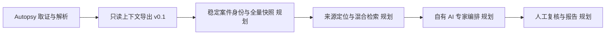

# Autopsy AI Workbench

面向可追溯证据研判的 Autopsy 扩展实验项目。第一版先提供 **本地、只读的案件元数据上下文导出**，为后续 AI 专家协作打好来源引用与覆盖核验基础。

This is an independent fork of [sleuthkit/autopsy](https://github.com/sleuthkit/autopsy), based on **Autopsy 4.23.1**. Autopsy and The Sleuth Kit are upstream projects; this fork is not an official release or an original implementation of their forensic engines. Original [README](README.txt), [license](LICENSE-2.0.txt), third-party notices and source history are retained. See [upstream attribution and fork changes](UPSTREAM.md).

## 现在可以做什么

- 不安装 Autopsy 即可运行合成案件演示，生成 `context.json` 与可阅读的 `review.md`。
- 通过 Autopsy 现有本地 MCP 接口读取案件汇总、数据源、文件、数据工件和分析结果元数据。
- 为每条返回记录生成本次导出内唯一的来源引用，保留 Autopsy 对象编号与原始返回字段。
- 标记数量上限、未知覆盖范围和采集期间可观察到的案件变化；不会把预览标记为全量处理。
- 提供 8 类专家的原创接入任务简报，明确记录为 `not_run`，便于后续接入自有专家服务。

**v0.1 尚未调用任何 AI 模型、读取文件正文或生成案件结论，也没有重新打包 Autopsy 安装程序。** 上游界面、取证引擎和既有 MCP 工具保持原样；本次新增代码位于 [`Tools/autopsy-ai-triage`](Tools/autopsy-ai-triage)。

## 两分钟运行演示

准备 Node.js 22 或更高版本。工具没有第三方依赖，无需 `npm install`。

```bash
git clone https://github.com/Dingyi-studios/autopsy-ai-workbench.git
cd autopsy-ai-workbench/Tools/autopsy-ai-triage
npm run demo
```

终端会显示本次输出目录。打开其中 `review.md` 查看预览，`context.json` 保存可供程序处理的结构化数据。

```bash
npm run demo -- --question "核对合同和通信中的待查线索" --limit 2
npm test
```

每次演示都使用完全合成的材料和 `example.invalid` 地址。输出文件夹默认被 Git 忽略。

## 连接本地 Autopsy

在 **Windows / Autopsy 4.23.1** 中打开案件并启用 MCP 后运行：

```powershell
cd Tools/autopsy-ai-triage
npm run collect -- --question "梳理合同相关材料，列出需要回读原文的线索" --out "C:/ForensicLocal/triage-preview" --limit 50
```

工具从 `%LOCALAPPDATA%/autopsy/mcp/` 读取端口和临时令牌，仅访问 `127.0.0.1`。它不会调用云端模型。请在符合案件数据存储要求的本地目录保存真实输出，不要提交或同步真实案件材料。

目前在 macOS / Node.js 22 完成了合成演示和模拟 HTTP 服务测试；**真实 Windows Autopsy 联调仍待验证**。详见 [工具用法](Tools/autopsy-ai-triage/README.md)。

## 演示输出

| 数据类别 | 合成记录数 | 覆盖状态 |
| --- | ---: | --- |
| 数据源 | 1 | 未证明完整性 |
| 文件 | 3 | 有上限的元数据预览 |
| 数据工件 | 2 | 有上限的元数据预览 |
| 分析结果 | 1 | 有上限的元数据预览 |

每项元数据附带 `ref:<exportId>:<section>:<index>`。这些引用只能定位本次导出中的元数据记录，不能代替原始文件的页码、字节区间或事实支持核验。

## 开发方向



下一步优先完成稳定案件身份、可分页的全量导出和正文定位，再接入资金、流量、内存、服务器、APK、EXE、文书通信及证据复核专家。参见 [架构与路线](docs/ai-workbench/architecture.md)。

## 许可证与贡献

本项目新增代码按 [Apache License 2.0](LICENSE-2.0.txt) 发布。Autopsy 原有代码、第三方组件、商标和各自权利声明保持有效，不能将本仓库的许可证理解为对全部捆绑组件的重新授权。未包含商业取证软件的安装包、逆向代码、专家文件或公司内部研究资料。

欢迎提交聚焦来源引用、导出可靠性、中文处理和可复核评测的 Issue / PR。请使用合成或有明确公开许可的数据复现问题。
